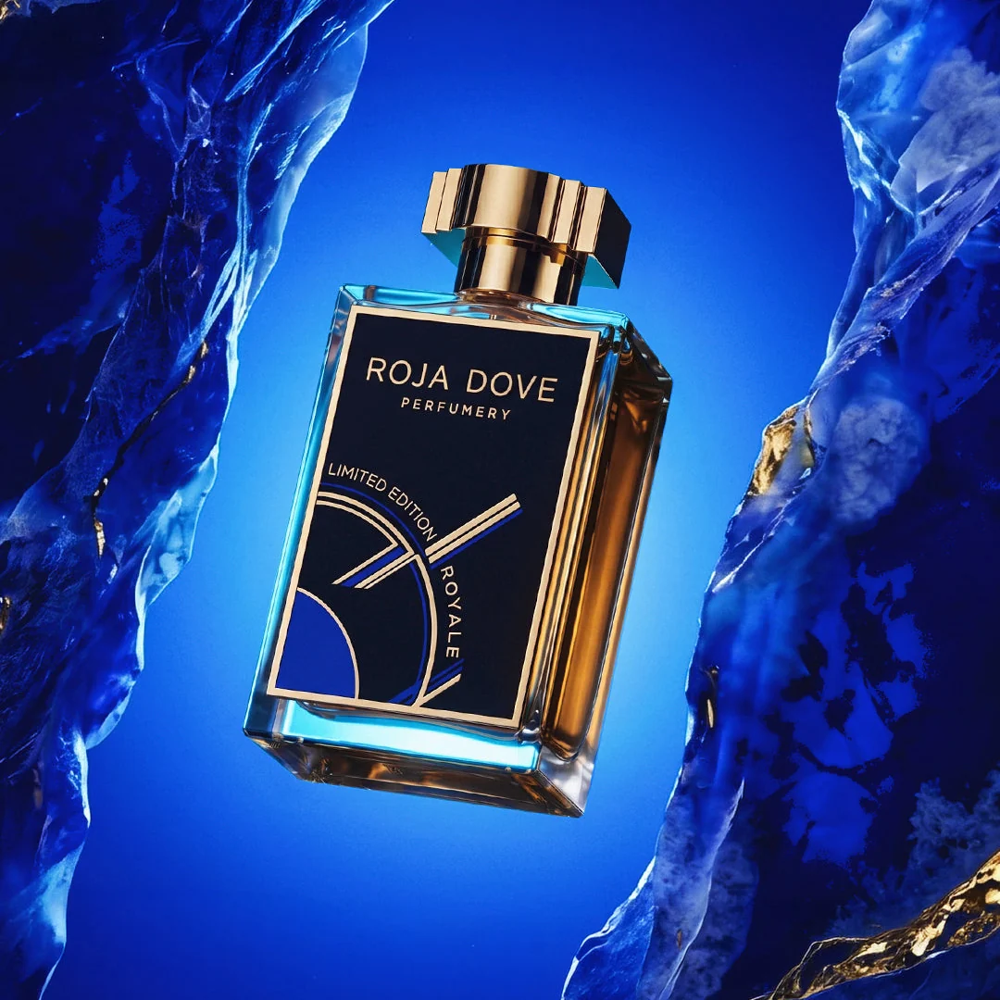

# ROJA DOVE ROYALE — Limited Edition Haute Parfumerie 3D Experience

An immersive, world-class 3D web experience built with **Three.js**, **GSAP**, and **Vanilla CSS**, celebrating the British Haute Parfumerie masterpiece: **Roja Dove Royale (Limited Edition • 500 Flacons)**.



---

## ✨ Features & Highlights

- **Photorealistic 3D Flacon Architecture**:
  - Precision-faceted French optical crystal glass bottle.
  - Radiant amber-gold liquid extrait core with caustics and internal suction dip tube.
  - Stepped 24K gold crown with precision-cut diamond facets.
  - High-gloss front label plaque with sapphire crescent artwork and gold typography.
- **Cinematic Scrollytelling Stages**:
  - **Hero Showcase**: Regal presence with floating gold stardust and atmospheric studio caustics.
  - **Olfactory Symphony**: 3-tier pyramid (Top, Heart, Base Notes) with interactive audio chord triggers, leaving dedicated empty space for the 3D bottle.
  - **Architectural Craftsmanship**: Highlight of the solid optical glass monolithic base, 24K gold stopper, and official archive captures.
  - **Bespoke 3D Flacon Engraving**: Real-time canvas text inscription generator with 360° bottle spin preview.
  - **Smooth Ethereal Exit**: The 3D model gracefully dissolves before the Connoisseur Reviews and VIP sections, ensuring 100% clean, editorial readability.
- **Web Audio API Sound Engine**:
  - Procedurally synthesized crystal glass chimes.
  - Authentic high-pressure aerosol perfume mist hisses.
  - Ambient subterranean luxury hum with mute/unmute control.
- **Exploded View Mode**:
  - Interactive mechanical explosion showcasing cap, collar, sprayer actuator, and crystal bottle separation in 3D.
- **Zero Lag / 60-120 FPS Rendering**:
  - Ultra-optimized `MeshStandardMaterial` pipelines with HDR reflections, avoiding expensive offscreen transmission buffers.

---

## 🛠️ Tech Stack

- **Core**: HTML5, Vanilla JavaScript (ES Modules)
- **Styling**: Vanilla CSS (Tailored HSL tokens, Glassmorphism, Responsive Grid)
- **3D Engine**: [Three.js](https://threejs.org/) (WebGL)
- **Animation**: [GSAP](https://greensock.com/gsap/)
- **Build Tool**: [Vite 5](https://vitejs.dev/)
- **Typography**: Google Fonts (*Cinzel*, *Cinzel Decorative*, *Plus Jakarta Sans*, *Space Grotesk*)

---

## 🚀 Getting Started

### Prerequisites

Ensure you have [Node.js](https://nodejs.org/) installed (v18 or higher recommended).

### Installation

1. Clone this repository:
   ```bash
   git clone https://github.com/<your-username>/roja-dove-royale-3d.git
   cd roja-dove-royale-3d
   ```

2. Install dependencies:
   ```bash
   npm install
   ```

3. Start development server:
   ```bash
   npm run dev
   ```

4. Open your browser and navigate to:
   ```
   http://localhost:5173/
   ```

---

## 📜 License

Created for demonstration and portfolio showcase. All brand names and visual trademarks belong to Roja Parfums / Roja Dove Perfumery Ltd.
